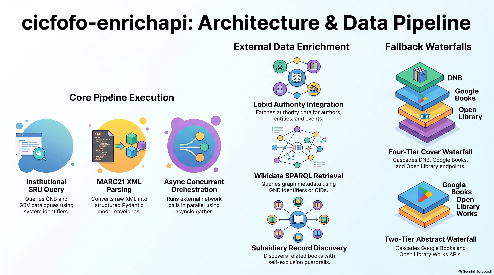
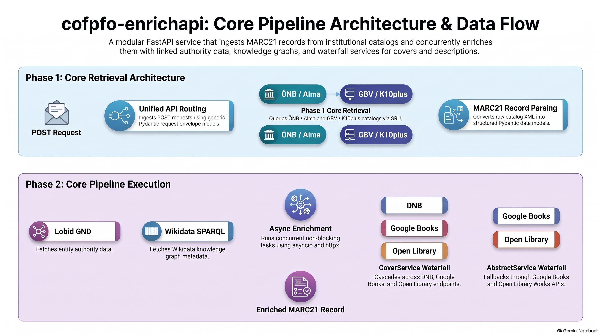
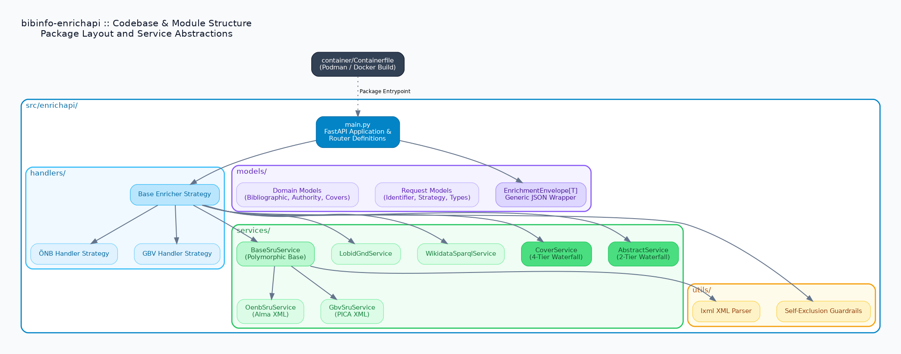
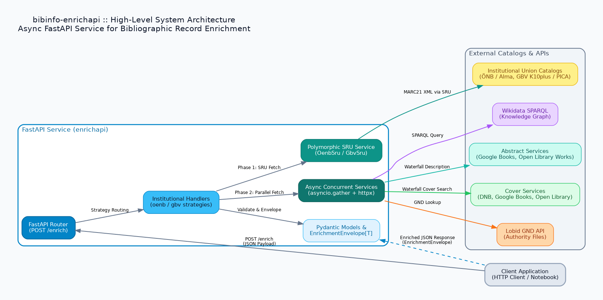
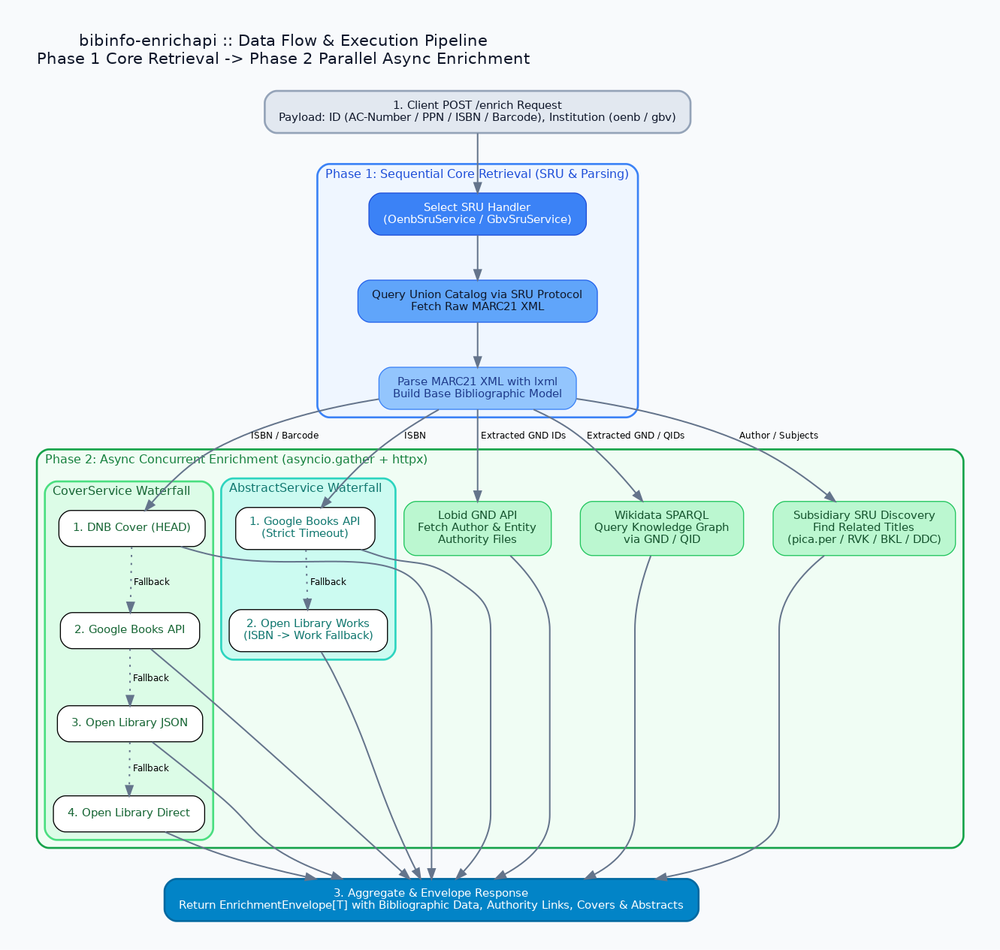
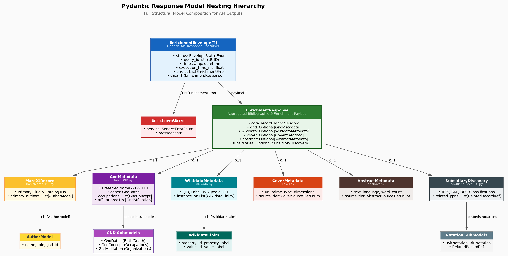

# Eine API und (k)ein Zweck  

**Klaus Prinz | ÖNB**

---

## Agenda

> Etwas für die Brille ohne die Brille.

 

* **Vorgeschichte & Überlegungen:** Warum das alles? Was habe ich mir dabei gedacht und wie bin ich es angegangen?
* **Komponenten, Flüsse & Modelle:** Welche Teile hat das Ding und wie wirken sie zusammen? Wie kann man sich den Datenfluss vorstellen? Nach welchen Modellen sind die Modelle modellhaft modelliert? Bunte Grafiken gibt es auch.
* **Live-Demo:** Es funktioniert wirklich.
* **Beratung:** Vielleicht ein wenig Hilfe?

---

## Vorgeschichte

> Wir haben VR-Brillen gekauft - übrigens sind sie von Apple.

 

* **BibInfo-Begleitprojekt:** Finden Sie bibliothekarische Anwendungszwecke für unsere VR-Brillen.
* **Ein Haufen Diskussionen:** Was machen wir damit? Wir wollen bitte schrauben, aber nicht alle.
* **Es geht um Anreicherung:** Voraussetzung ist, dass jemand sich die Brille aufsetzt.
* **Eine Anreicherungsschnittstelle:** Der mittlere Teil eines Dreischritts.

---

## Überlegungen

> Und wie mache ich das jetzt eigentlich? Sinnvoll und modular aufgebaut soll es auch sein.

 

* **Python:** Ja.
* **OOP**: Jetzt komme ich nicht mehr darum herum.
* **FastAPI:** Der Name ist Programm. Geschenke bekommt man auch.
* **Pydantic:** Modelle, Validierungen und Mappings. Es ist großartig.
* **Asynchronizität:** Wenn wir schon dabei sind.
* **Mit dem Furor des Konvertiten:** Git und GitHub am besten auch.
 
* **Jetzt kommt was Lustiges**

---

---

---

## Komponenten & Architektur

---

## Architektur & Komponenten

---

## Datenfluss

---

## Response-Modell-Struktur

---

## Jetzt reicht es mit den NotebookLM-Grafiken

> Weiter oben stand etwas von Geschenken, oder?

 

* **Swagger UI:** [http://localhost:8000/docs](http://localhost:8000/docs)
* **Redoc:** [http://localhost:8000/redoc](http://localhost:8000/redoc)

---

## Live-Demo

> Schauen wir mal rein ins Packerl.

 

* [Example Calls and Mini Pipes [`notebooks/exampleUsage.ipynb`]](../../notebooks/exampleUsage.ipynb)
* [Pipeline Tests [`notebooks/testPipeline.ipynb`]](../../notebooks/testPipeline.ipynb)

---

## Logs und technische Doku

> Diesmal auch das.

 

* **Logs:** `podman logs enrichapi`, `podman logs enrichapi 2>&1 | grep "WARNING"`.
* **Technische Doku:** [docs/api/index.html](../../docs/api/index.html) 

---

## Wie ging es im Projekt weiter?

> Eh okay.

 

* **Mach den Browser auf, Klaus** - und zeig es her.
* **Nimm dein Smartphone, Klaus** - und zeig es her.

---

## Und (k)ein Zweck

> Irgendetwas muss man doch damit tun können?

 

* **Bitte gebt meiner API einen Zweck.**
* **Habt ihr Ideen für Anwendungen?**
* **Fragen auch gern.**

---

## Vielen Dank für eure Aufmerksamkeit!

 

> **Hier ist das Zeug:**
> 🔗 [https://github.com/klausbprinz/bibinfo-enrichapi](https://github.com/klausbprinz/bibinfo-enrichapi)
